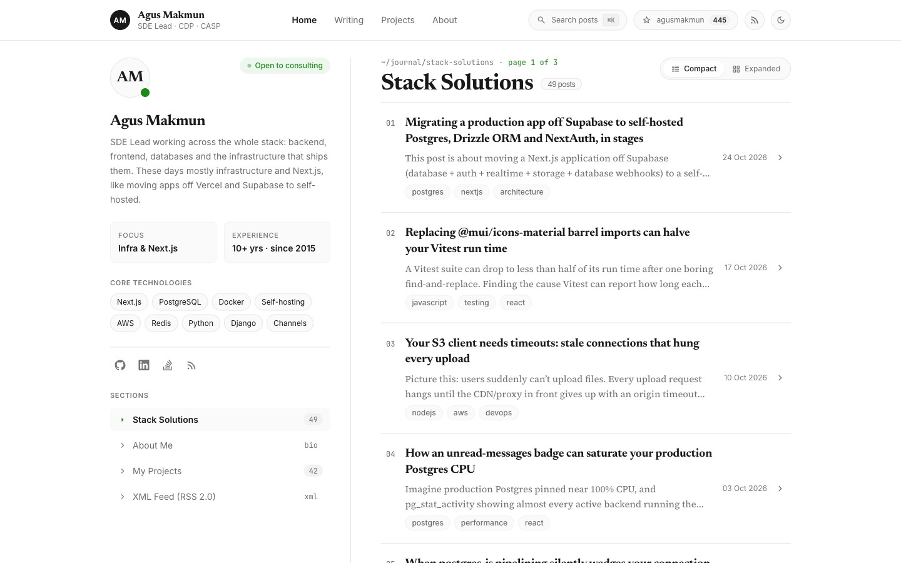
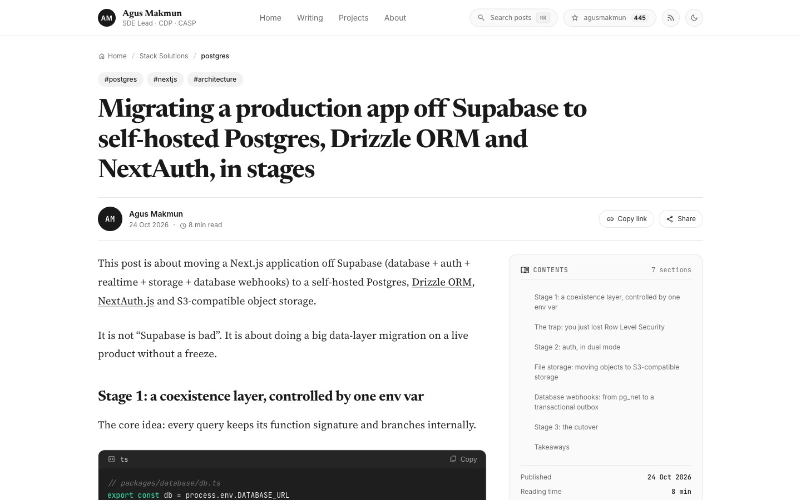
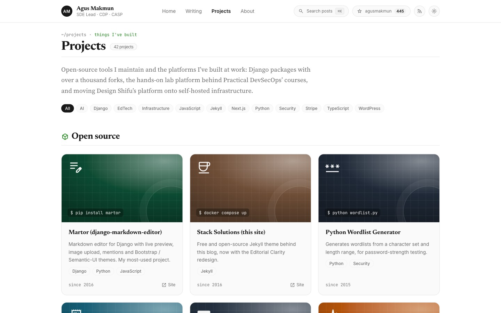
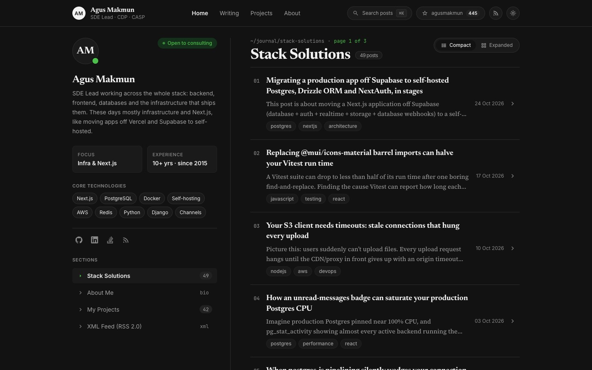
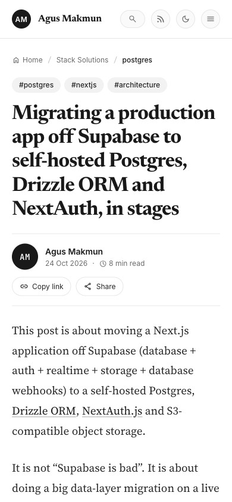

## ☕ Stack Solutions

A minimalist, editorial Jekyll theme for technical blogs and personal portfolios.
It powers [agusmakmun.github.io](https://agusmakmun.github.io).

The design takes its cues from [Medium](https://medium.com): serif headlines, a comfortable reading column,
quiet hairline borders and a single accent green. It also adds tools for developers, such as ⌘K search,
code blocks with copy buttons and a sticky table of contents. It's built with plain CSS and a small vanilla JS file:
no Bootstrap, no jQuery and no CSS framework.



| Article                                       | Projects                                           |
| --------------------------------------------- | -------------------------------------------------- |
|  |  |

| Dark mode                                                    | Mobile                                               |
| ------------------------------------------------------------ | ---------------------------------------------------- |
|  |  |

### Features

**Reading (Medium-inspired)**

- Editorial typography: Newsreader headlines, Source Serif 4 body text, Inter for the UI and JetBrains Mono for code
- Article pages with a large title, author byline, reading time, topic pills and a sticky, auto-generated table of contents with scroll spy
- Dark code blocks with language labels and a copy button (Rouge syntax highlighting)
- Author card, previous/next post links, related posts and Disqus comments
- Share menu (X, LinkedIn, Facebook, Hacker News, email) plus the system share sheet where the browser has one, and copy link

**Browsing**

- Home page with a sticky profile sidebar and a numbered post list in two views, _Compact_ and _Expanded_, each with a short excerpt
- Shortened pagination (`1 … 4 5 6 … 20`), a `/writing/` archive grouped by year, and category pages
- ⌘K / Ctrl+K search dialog with keyboard navigation (searches titles and categories)

**Portfolio**

- `/projects/`: open-source and work projects with generated covers (gradient, icon and command line), filtered by tag
- `/about/`: bio, career highlights, experience timeline, certifications and a tools icon grid
- Live GitHub star count in the header

**Under the hood**

- Light/dark theme that follows the system setting, can be toggled and is remembered per visitor
- Responsive down to phone width, with a mobile menu
- SEO via [jekyll-seo-tag](https://github.com/jekyll/jekyll-seo-tag): canonical URLs, Open Graph and large Twitter cards, JSON-LD (`BlogPosting`, `WebSite`, `Person`)
- Every page gets a meta description: a post's own `description`, or one generated from its opening text
- Default share image (`static/img/og-default.png`), `robots.txt`, standard XML sitemap and RSS feed
- A 404 page in the site's design
- Icon font trimmed to only the Material Symbols the site uses
- Cache-busted CSS/JS on each build, HTML minified with [Jekyll Compress HTML](https://github.com/penibelst/jekyll-compress-html)
- Google Analytics (GA4), loaded only in production and only when an ID is set
- Deployed by GitHub Actions to GitHub Pages (Jekyll 4)

### Configuration

| File                           | What it controls                                                                                                                                                                                                                                                                                               |
| ------------------------------ | -------------------------------------------------------------------------------------------------------------------------------------------------------------------------------------------------------------------------------------------------------------------------------------------------------------- |
| `_config.yml`                  | Site title, description and author; `tagline`, `about`, `status`, `profile_stats` and `stack` (header and home sidebar); `social_links` (sidebar icons) and `nav`; `social` (profile links for SEO); `repo` (header star count); `disqus_shortname`; `google_analytics` (GA4 `G-…` ID, leave empty to disable) |
| `about.md`                     | The About page text and the `skills` icon list                                                                                                                                                                                                                                                                 |
| `_data/work.yml`               | About page: `highlights` (number, label, source) and the `experience` timeline                                                                                                                                                                                                                                 |
| `_data/projects.yml`           | Projects: `featured` and `more` (open source) and `work`. Each card's `icon` is a [Material Symbols](https://fonts.google.com/icons) name, and `color` and `cmd` style its cover                                                                                                                               |
| `_includes/brand-icon.html`    | Brand logos (GitHub, LinkedIn, X, …) as inline SVG; add new ones here                                                                                                                                                                                                                                          |
| `_includes/icon-font.html`     | Which Material Symbols get loaded. Icons from `_data` are added automatically; icons written in a template or `site.js` must be added to its `fixed` list, or they show as plain text                                                                                                                          |
| `_plugins/auto_description.rb` | Generates descriptions for posts and category pages that don't set one                                                                                                                                                                                                                                         |
| `static/img/og-default.png`    | Default image for link previews on LinkedIn, X, Slack and so on                                                                                                                                                                                                                                                |
| `static/css/site.css`          | All styles; the colour and font tokens are at the top, with dark mode under `[data-theme="dark"]`                                                                                                                                                                                                              |
| `static/js/site.js`            | Theme toggle, search, share menu, table of contents, code copy buttons, project filter                                                                                                                                                                                                                         |

### Writing posts

Posts are Markdown files in `_posts/`, named `YYYY-MM-DD-slug.md`:

<!-- prettier-ignore -->
```markdown
---
layout: post
title: "Your Title"
date: 2026-10-24 20:00:00 +0700
categories: [postgres, nextjs]        # each needs a page in category/ (see below)
description: "One or two sentences."  # optional: list excerpt, search results and share previews
image: /static/img/_posts/cover.png   # optional: share image (defaults to static/img/og-default.png)
---

Your content in Markdown…
```

- Without a `description`, one is generated from the post's opening text (code blocks skipped) and used for the list excerpt, search results and share previews. Write your own for important posts.
- `##` and `###` headings automatically appear in the article's table of contents.
- Every category needs a page in `category/`. Copy an existing one, e.g. `category/django.md`, and change `categories`, `title` and `permalink`.

### Adding a project

Add an entry to `_data/projects.yml` under `featured` (open source with a cover), `more` (one-line list) or `work`:

```yaml
featured:
  - name: My Tool
    repo: agusmakmun/my-tool # GitHub repo; the card links here
    url: https://my-tool.dev # optional: "Site" link
    since: 2026
    tags: [Python, Django] # used by the tag filter
    icon: build # Material Symbols name, https://fonts.google.com/icons
    color: '#0c4b33' # cover colour
    cmd: pip install my-tool # line shown on the cover
    summary: One or two sentences about what it does.
```

Work projects use `company` and `years` instead of `repo` and `since`. Keep them public-safe: no customer or
employee names, prices, internal hostnames or incidents.

### Running locally

Requirements: [Docker](https://www.docker.com/) for the site, and [Node.js](https://nodejs.org/) only for `make format`.

```sh
make serve            # same as: docker compose up
```

**Or with Ruby 3.x:**

```sh
bundle config set --local path vendor/bundle
bundle install
bundle exec jekyll serve --livereload
```

Then open http://localhost:4000. Pages reload on save; changes to `_config.yml` or the `Gemfile` need a restart
(`docker compose restart`).

### Formatting and checks

```sh
make format   # Prettier on CSS, JS, YAML and the README (via npx, no package.json needed)
make check    # formatting check + production build + internal link check (html-proofer)
```

Liquid templates (`_layouts`, `_includes`, `*.html` pages) and `_posts` are not run through Prettier on purpose:
it doesn't understand Jekyll's Liquid tags, and reformatting old posts would be noise. The link check skips external
links, the share menu's recipient-less `mailto:`, and `http://` links inside old posts.

### Deploying

Pushing to `master` runs `.github/workflows/pages.yml`, which builds with `JEKYLL_ENV=production` and publishes to
GitHub Pages. In the repository settings, set **Pages → Source** to _GitHub Actions_.

The Actions build is required, not optional: GitHub Pages' built-in builder only supports Jekyll 3 and a fixed plugin list,
so it would skip `_plugins/auto_description.rb` and fail on Jekyll 4. Run `make check` before pushing.

### Credits

- Originally forked from [A simple grey theme for Jekyll](https://github.com/liamsymonds/simplygrey-jekyll).
- Design inspired by [Medium](https://medium.com). This is an independent theme, not affiliated with Medium.
- Icons: [Material Symbols](https://fonts.google.com/icons), brand logos from [Simple Icons](https://simpleicons.org) (CC0), tool icons on the About page from [skillicons.dev](https://skillicons.dev).

### Contributing

Feel free to [open an issue](https://github.com/agusmakmun/agusmakmun.github.io/issues) or [send a pull request](https://github.com/agusmakmun/agusmakmun.github.io/pulls)!

### License

[MIT](LICENSE)
